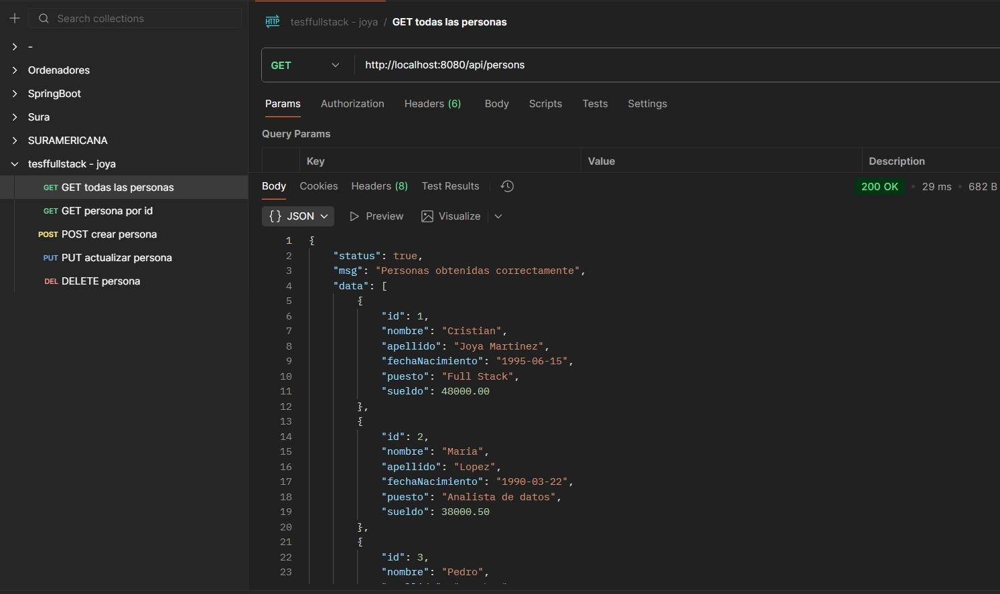
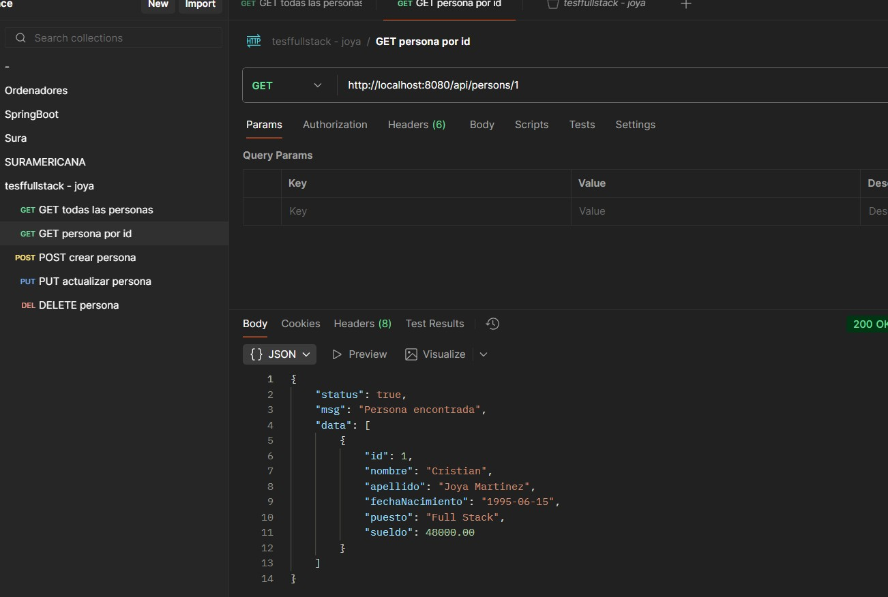
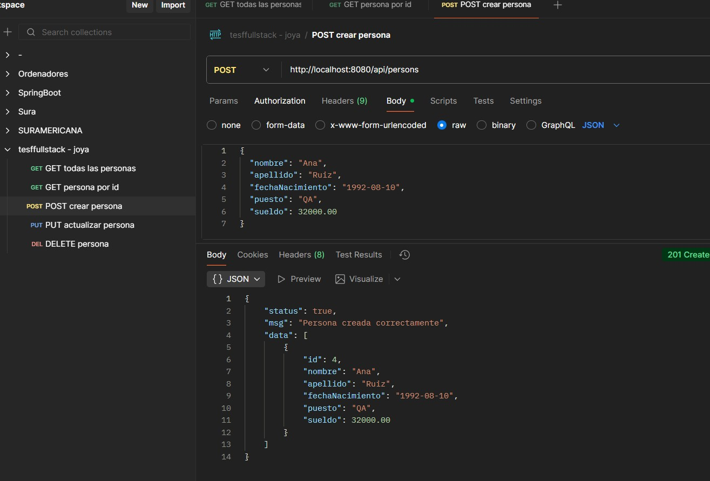
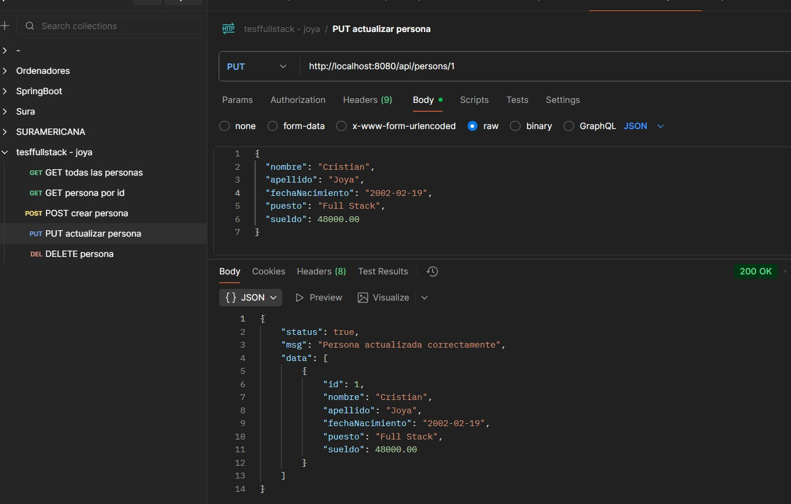
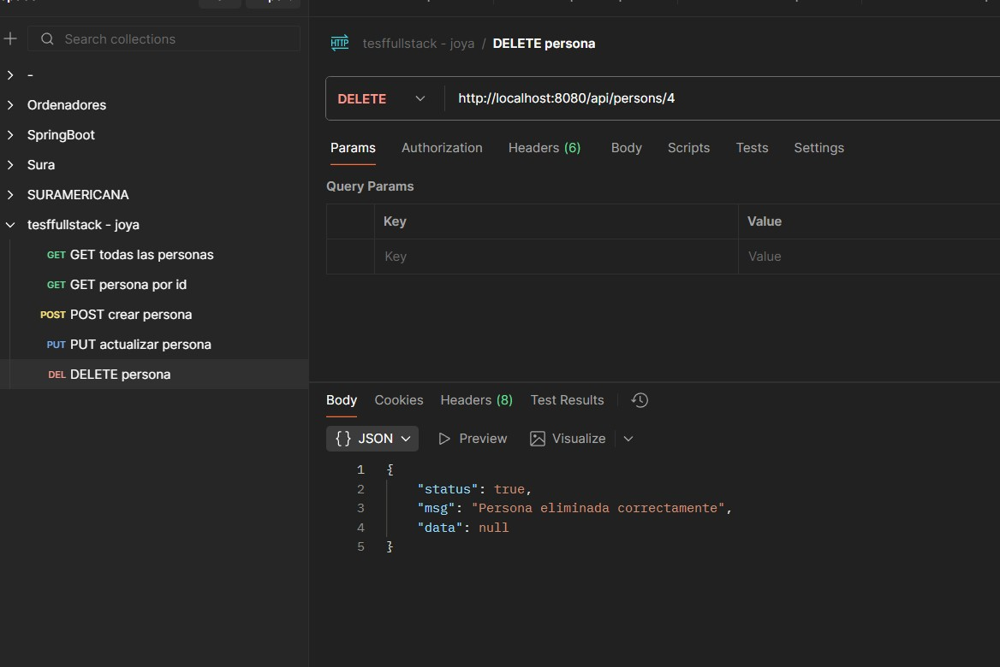
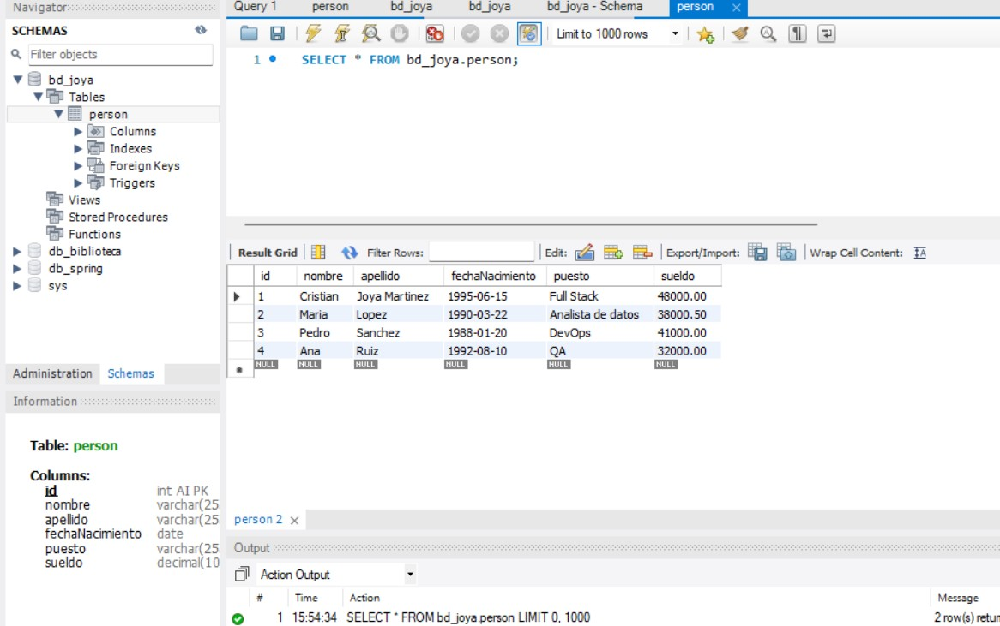
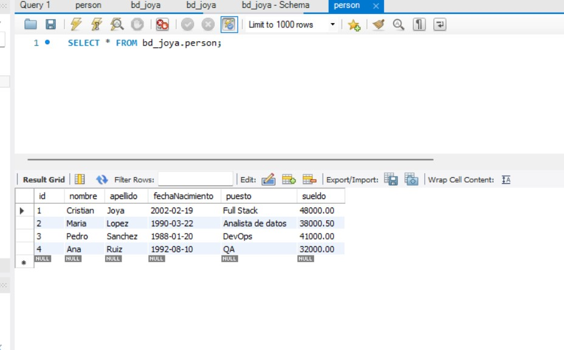
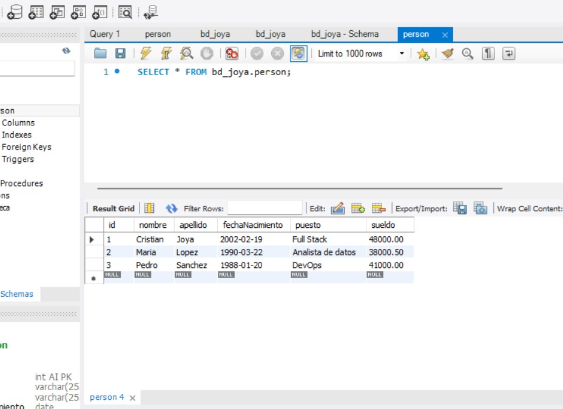

# API REST — rama `joya_backend`

**Autor:** Cristian Joya  
**Stack:** Java 17 · Spring Boot 3.2 · Spring Data JPA · Maven · MySQL 8  
**Base URL:** `http://localhost:8080`

## Contexto

Servicio REST que implementa el CRUD de personas sobre la base `bd_joya` (rama `joya_bd`). Centraliza la lógica de acceso a la tabla `person` y expone un contrato JSON uniforme para el cliente Angular.

## Contrato de respuesta

Todas las operaciones responden con la estructura definida en la prueba:

| Campo | Tipo | Descripción |
|-------|------|-------------|
| `status` | boolean | Resultado de la operación |
| `msg` | string | Mensaje descriptivo |
| `data` | array \| null | Registros devueltos o `null` en operaciones sin cuerpo |

```json
{
  "status": true,
  "msg": "Personas obtenidas correctamente",
  "data": [
    {
      "id": 1,
      "nombre": "Cristian",
      "apellido": "Joya",
      "fechaNacimiento": "1995-06-15",
      "puesto": "Desarrollador Full Stack",
      "sueldo": 45000.00
    }
  ]
}
```

## Endpoints

| Método | Ruta | Descripción |
|--------|------|-------------|
| `GET` | `/api/persons` | Listado completo |
| `GET` | `/api/persons/{id}` | Consulta por identificador |
| `POST` | `/api/persons` | Registro de persona |
| `PUT` | `/api/persons/{id}` | Actualización |
| `DELETE` | `/api/persons/{id}` | Eliminación |

## Persistencia

| Parámetro | Valor |
|-----------|-------|
| JDBC URL | `jdbc:mysql://localhost:3306/bd_joya` |
| Usuario | `conexion` |
| Esquema | Gestionado por scripts SQL (`joya_bd`) |
| Hibernate DDL | `none` |

La entidad `Person` mapea la tabla `person` con `GenerationType.IDENTITY`, alineado al `AUTO_INCREMENT` del script de base de datos. La estrategia de nombres físicos respeta las columnas camelCase del esquema (`fechaNacimiento`).

## Integración frontend

CORS habilitado para `http://localhost:4200` (rama `joya_frontend`).

## Estructura

```
backend/
├── src/main/java/com/joya/testfullstack/
│   ├── controller/PersonController.java
│   ├── model/Person.java, ApiResponse.java
│   └── repository/PersonRepository.java
├── src/test/java/com/joya/testfullstack/
│   ├── controller/PersonControllerTest.java
│   └── model/ApiResponseTest.java
└── src/main/resources/application.properties
```

## Pruebas unitarias

Cobertura del contrato REST sin dependencia de MySQL, mediante `@WebMvcTest` y repositorio simulado:

| Clase | Alcance |
|-------|---------|
| `PersonControllerTest` | CRUD completo: respuestas exitosas y errores por id inexistente |
| `ApiResponseTest` | Fabrica de respuestas `ok` / `error` |

Ejecución:

```bash
mvnw.cmd test
```

## Despliegue

Requiere MySQL con `bd_joya` provisionada y el servicio levantado en el puerto `8080`. El proyecto incluye Maven Wrapper (`mvnw` / `mvnw.cmd`) para compilar y ejecutar sin dependencia de Maven global.

## Evidencia Postman

Colección: [`postman/tesffullstack-joya.postman_collection.json`](../postman/tesffullstack-joya.postman_collection.json)

### Operaciones API

**GET — Listado de personas**



**GET — Persona por identificador**



**POST — Alta de persona**



**PUT — Actualización de persona**



**DELETE — Eliminación de persona**



### Validación en base de datos

Comprobación en MySQL tras operaciones de escritura:






