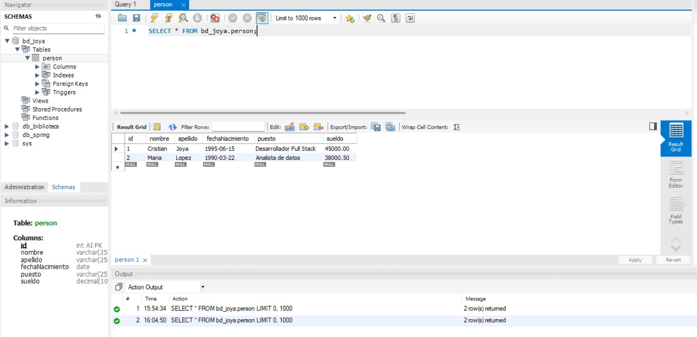

# Módulo de base de datos — `joya_bd`

**Autor:** Cristian Joya  
**Motor:** MySQL 8.0  
**Base de datos:** `bd_joya`

## Contexto

Este módulo define la capa de persistencia para la prueba técnica full stack. La base `bd_joya` centraliza el catálogo de personas que consumirán, en fases posteriores, el servicio REST (rama `joya_backend`) y la aplicación Angular `frontend_joya`.

La nomenclatura sigue el criterio del examen: prefijo `bd_` + apellido del desarrollador.

## Modelo de datos

La entidad principal es la tabla `person`, diseñada para soportar el CRUD de la aplicación:

| Campo | Tipo | Restricción | Rol |
|-------|------|-------------|-----|
| `id` | `INT` | `PRIMARY KEY`, `AUTO_INCREMENT` | Identificador interno |
| `nombre` | `VARCHAR(255)` | — | Nombre de la persona |
| `apellido` | `VARCHAR(255)` | — | Apellido |
| `fechaNacimiento` | `DATE` | — | Fecha de nacimiento |
| `puesto` | `VARCHAR(255)` | — | Puesto laboral |
| `sueldo` | `DECIMAL(10,2)` | — | Remuneración |

El identificador autoincremental garantiza integridad referencial simple y compatibilidad directa con JPA (`GenerationType.IDENTITY`) en el backend.

## Seguridad y acceso

Se definió un usuario dedicado para la aplicación, separado del administrador del servidor:

| Parámetro | Valor |
|-----------|-------|
| Usuario | `conexion` |
| Host | `localhost` |
| Alcance de permisos | `ALL PRIVILEGES` sobre `bd_joya.*` |
| Contraseña | `Joy@Bd2026!x7` |

Con esto el backend se conecta con credenciales de mínimo privilegio sobre un único esquema, sin exponer el usuario `root` del motor.

## Artefactos entregados

- **`script_creacion_bd.sql`** — Provisiona la base `bd_joya`, crea `person` e incluye registros semilla para validar el entorno.
- **`02_crear_usuario_conexion.sql`** — Registra el usuario `conexion` y aplica los grants correspondientes.

Ambos scripts son idempotentes en la creación de objetos (`IF NOT EXISTS` / `CREATE USER IF NOT EXISTS`) para permitir re-ejecución sin fallos en entornos ya provisionados.

## Entorno de validación

La implementación fue probada en **MySQL Server 8.0** (Windows), con ejecución de scripts desde MySQL Workbench y verificación de lectura/escritura mediante el usuario `conexion`.

## Evidencia

Captura del esquema y datos cargados tras la ejecución local:

## Consideraciones

Los `INSERT` iniciales son datos de prueba para confirmar conectividad y mapeo; no representan información productiva. El esquema puede extenderse en iteraciones futuras (índices, auditoría, soft delete) sin impactar el contrato actual del API.
