# Cliente Angular — rama `joya_frontend`

**Autor:** Cristian Joya  
**Proyecto:** `frontend_joya`  
**Stack:** Angular 20 · Angular Material · TypeScript · SCSS  
**Puerto de desarrollo:** `4200`

## Contexto

Aplicación SPA que consume la API REST de la rama `joya_backend` para administrar el catálogo de personas. Implementa el flujo completo solicitado en la prueba: listado, alta, edición y eliminación, con retroalimentación visual al usuario según el contrato `status` / `msg` / `data`.

## Funcionalidad

| Pantalla | Ruta | Descripción |
|----------|------|-------------|
| Listado | `/` | Tabla con todas las personas; acciones Crear, Editar y Borrar por registro |
| Alta | `/nuevo` | Formulario vacío con botones Guardar y Cancelar |
| Edición | `/editar/:id` | Formulario precargado con los datos actuales |

## Integración

| Parámetro | Valor |
|-----------|-------|
| API base | `http://localhost:8080/api/persons` |
| CORS | Habilitado en backend para `http://localhost:4200` |

## Estructura

```
frontend/frontend_joya/
├── src/app/
│   ├── pages/person-list/      # Listado y eliminación
│   ├── pages/person-form/      # Crear y editar
│   ├── services/person.service.ts
│   └── models/
└── src/styles.scss             # Tema Material y estilos globales
```

## Diseño

Interfaz basada en Angular Material: barra superior fija, tarjetas con sombra suave, tabla responsiva, formulario en rejilla de dos columnas, diálogo de confirmación para borrado y notificaciones tipo snackbar según el resultado de la API.

## Despliegue local

Requisitos: Node.js, npm y backend activo en el puerto `8080`. La aplicación se ejecuta con `ng serve` desde `frontend/frontend_joya` y queda disponible en `http://localhost:4200`.

## Evidencia

Capturas de la operación en el navegador (`capturas/`).

### Listado principal

Vista inicial con el directorio de personal y acciones por registro.

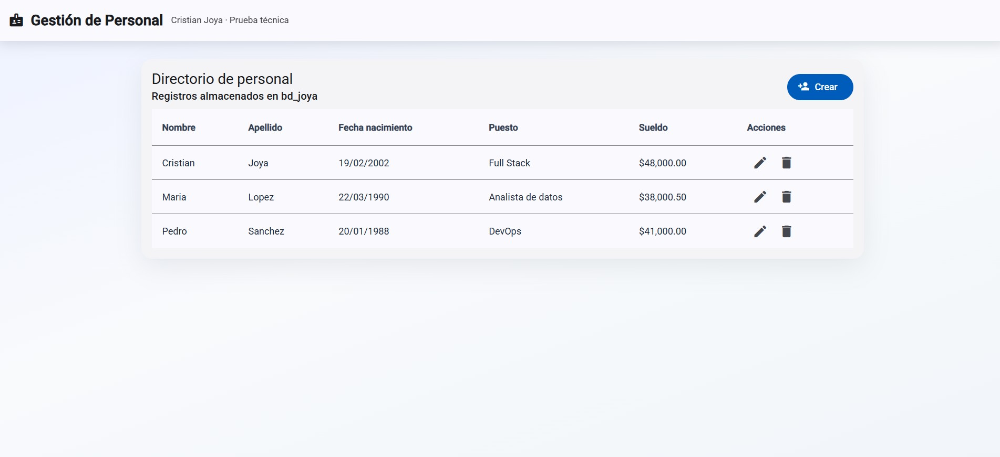

### Alta de persona

Formulario de registro, validación de campos obligatorios y confirmación de creación.

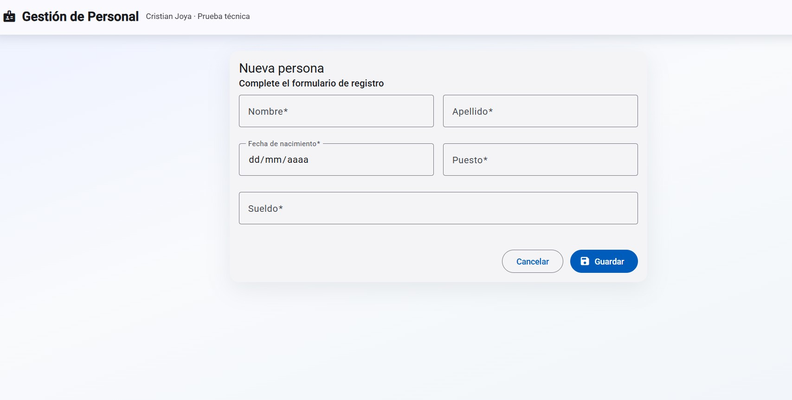

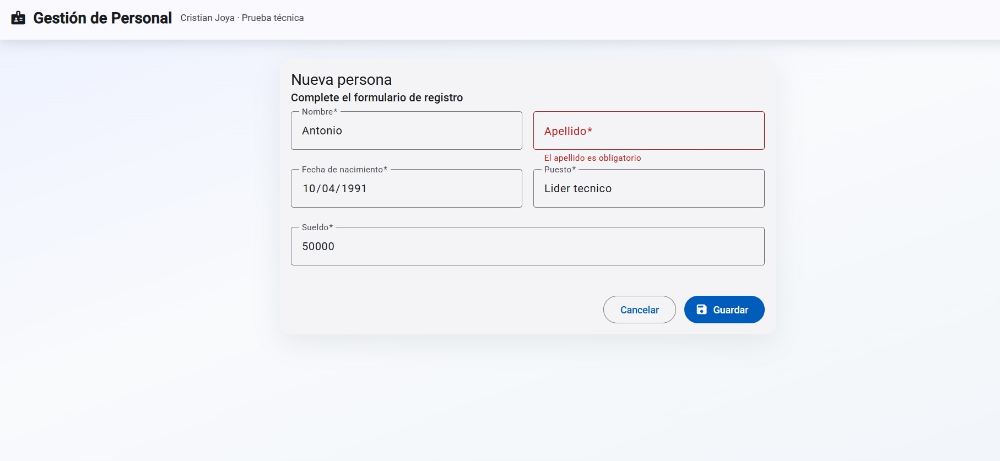

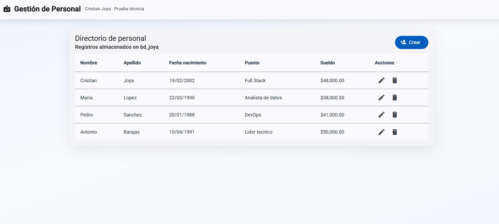

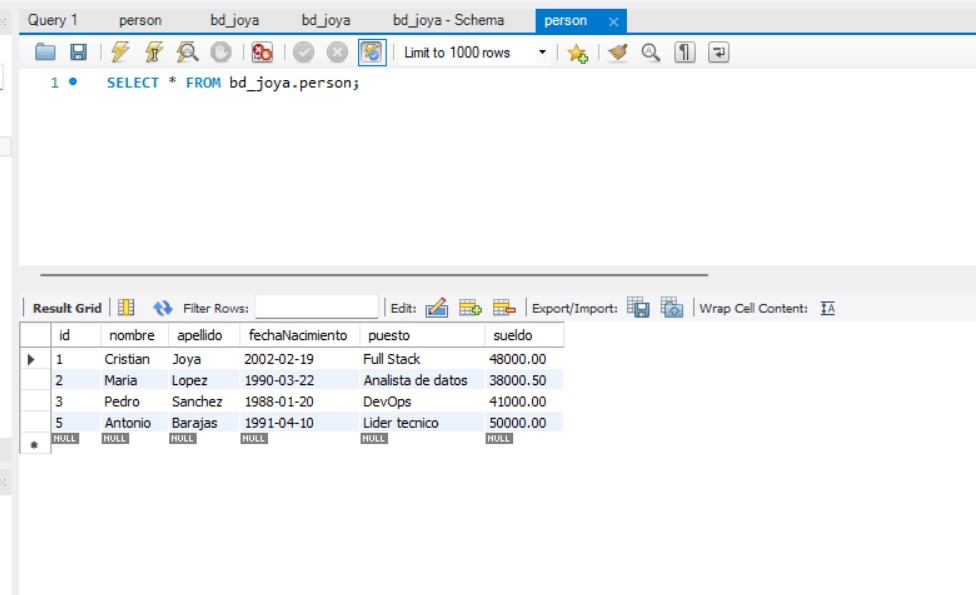

### Edición de persona

Carga de datos existentes, actualización desde el formulario y verificación en BD.

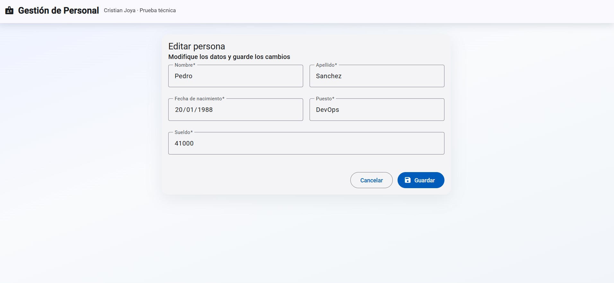

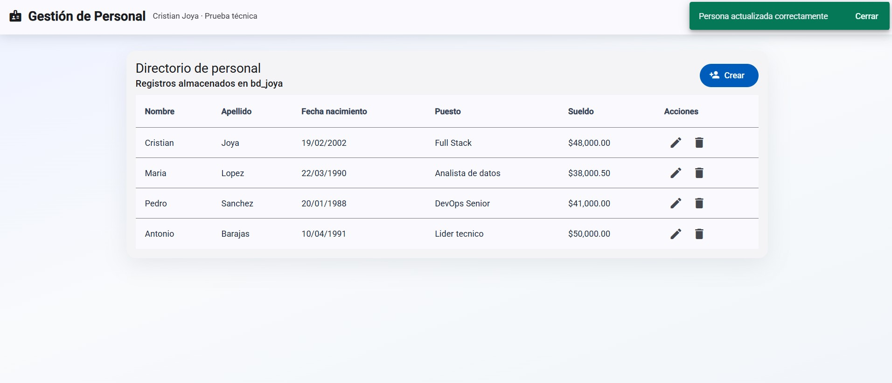

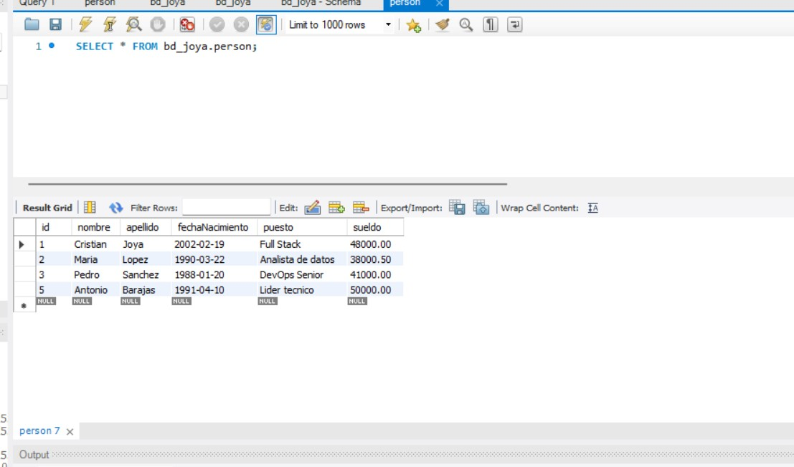

### Eliminación de persona

Confirmación de borrado, resultado en la interfaz y comprobación en BD.

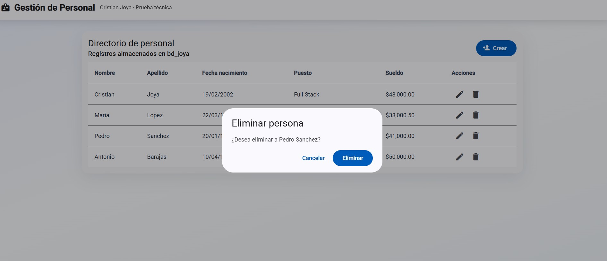

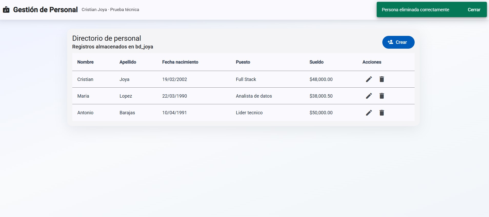

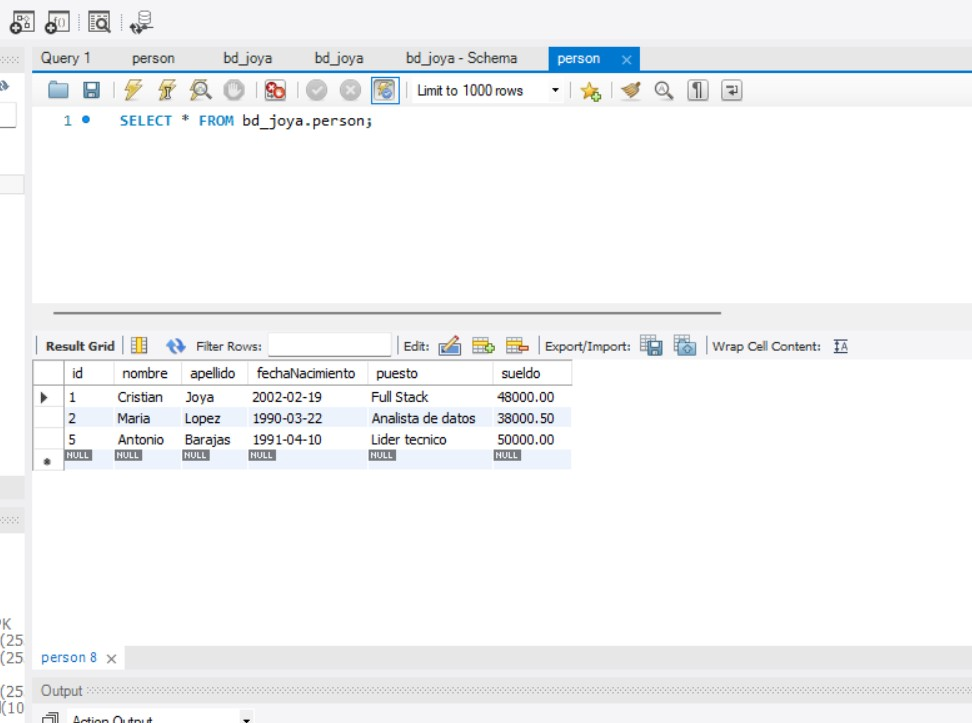
